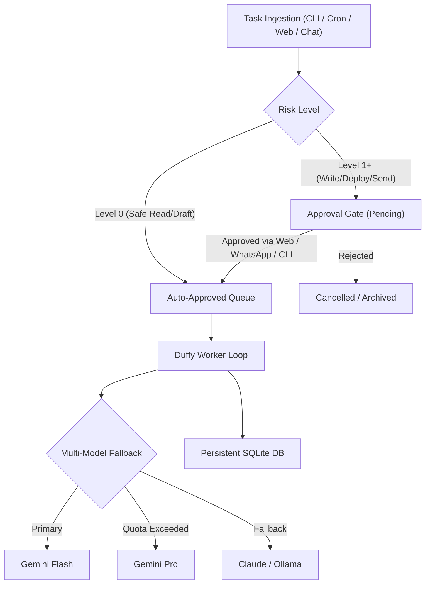

# DUFFY 🦆 — Zero-Cost Autonomous Background Agent & Approval Queue

<p align="center">
  
  
  
  
  
</p>

**DUFFY** is an open-source, 24/7 autonomous background worker daemon designed to execute long-running AI tasks, research jobs, bug fixes, and scheduled routines with **zero API cost** via multi-model quota cycling, backed by a strict **Human-in-the-Loop (HITL) approval queue**.

---

## 🌐 Quick Language Selector / Çok Dilli Özet
- [English](#-english)
- [Türkçe](#-türkçe)
- [日本語](#-日本語)
- [中文](#-中文)
- [Deutsch](#-deutsch)
- [Español](#-español)

---

## 🇬🇧 English

### Why Duffy?
Existing AI agents often burn expensive API credits or execute dangerous actions unchecked. Duffy solves this:
1. **0 EUR API Cost:** Cycles through free local/cloud CLI quotas (Gemini, Claude, Ollama, OpenAI) with automatic fallback.
2. **Human-in-the-Loop (HITL):** High-risk actions (code deployments, emails, payments) are held in a persistent SQLite queue until approved via Web UI, WhatsApp, or CLI.
3. **Headless & Background-First:** Runs silently on low-power servers, old laptops, or Raspberry Pis without opening GUI windows.

### Architecture


### Quickstart
```bash
# Clone and run
git clone https://github.com/benfirad/daak-duffy.git
cd daak-duffy

# Start background daemon & web dashboard
python3 duffy.py daemon

# In another terminal: enqueue a task
python3 duffy.py add -p "Audit system logs and draft daily report" -r 0

# Open Dashboard
# http://localhost:8899
```

---

## 🇹🇷 Türkçe
**Duffy**, 7/24 arka planda kesintisiz çalışan, çoklu model havuzuyla **0 EUR API maliyetiyle** görev icra eden ve kritik aksiyonlarda **insan onay mekanizması (Human-in-the-Loop)** barındıran açık kaynaklı bir yapay zeka işçisidir.
- **Onay Kuyruğu:** Riskli eylemler (kod gönderme, mail atma, sistem ayarları) WhatsApp, Web Paneli veya Terminal üzerinden onaylanana kadar bekletilir.
- **Headless:** Eski Mac'lerde, Linux sunucularda veya mini PC'lerde ekranda hiçbir pencere açmadan arka planda çalışır.

---

## 🇯🇵 日本語
**Duffy**は、24時間365日バックグラウンドで自律稼働するオープンソースのAIワーカーデーモンです。
- **APIコスト0円:** Gemini、Claude、Ollamaなどの無料クォータを自動巡回・フォールバック。
- **人間の承認キュー (HITL):** 危険なコマンドや外部通信は、Web UI、WhatsApp、CLIで承認されるまで安全に待機。

---

## 🇨🇳 中文
**Duffy** 是一款开源的 7x24 小时后台自主运行 AI 任务执行器。
- **零 API 成本:** 自动在各类免费配额和本地模型间智能轮回调度。
- **人机协同审批 (HITL):** 关键与高危任务必须经过网页仪表盘、WhatsApp 或命令行一键批准方可执行。

---

## 🇩🇪 Deutsch
**Duffy** ist ein autonomer 24/7-Hintergrund-Agent mit integrierter Genehmigungswarteschlange (Human-in-the-Loop) und automatischem Multi-Modell-Fallback für 0 EUR API-Kosten.

---

## 🇪🇸 Español
**Duffy** es un agente autónomo que opera 24/7 en segundo plano con cola de aprobación humana (HITL) y conmutación por error entre modelos gratuitos sin costo de API.

---

## 🛠️ CLI Reference
| Command | Description | Example |
|---|---|---|
| `python3 duffy.py daemon` | Starts background daemon & HTTP dashboard | `python3 duffy.py daemon` |
| `python3 duffy.py add` | Adds a new task with risk classification | `python3 duffy.py add -p "Analyze PR" -r 1` |
| `python3 duffy.py list` | Displays current tasks and their status | `python3 duffy.py list` |
| `python3 duffy.py approve` | Approves a gated task by ID | `python3 duffy.py approve --id 4` |
| `python3 duffy.py reject` | Rejects a gated task by ID | `python3 duffy.py reject --id 4` |

---

## 📄 License
MIT License. Developed by DAAK Systems. Contributions welcome!
