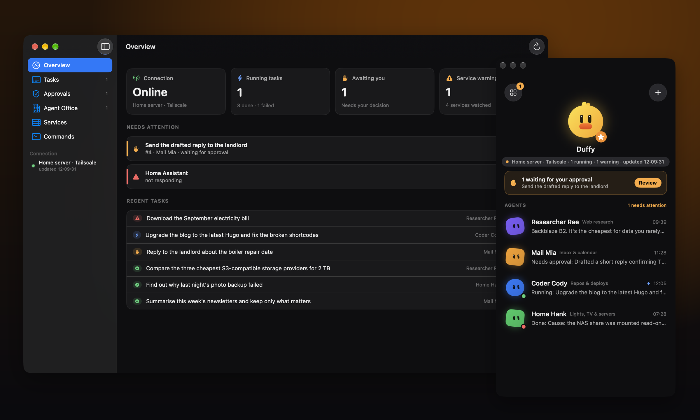
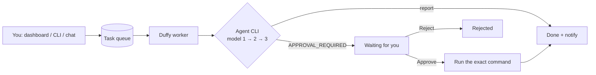
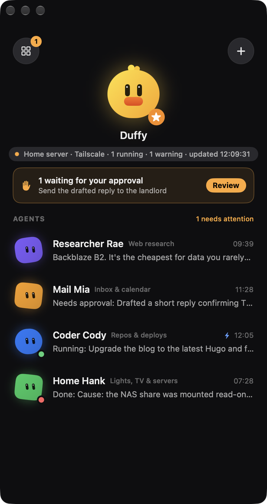
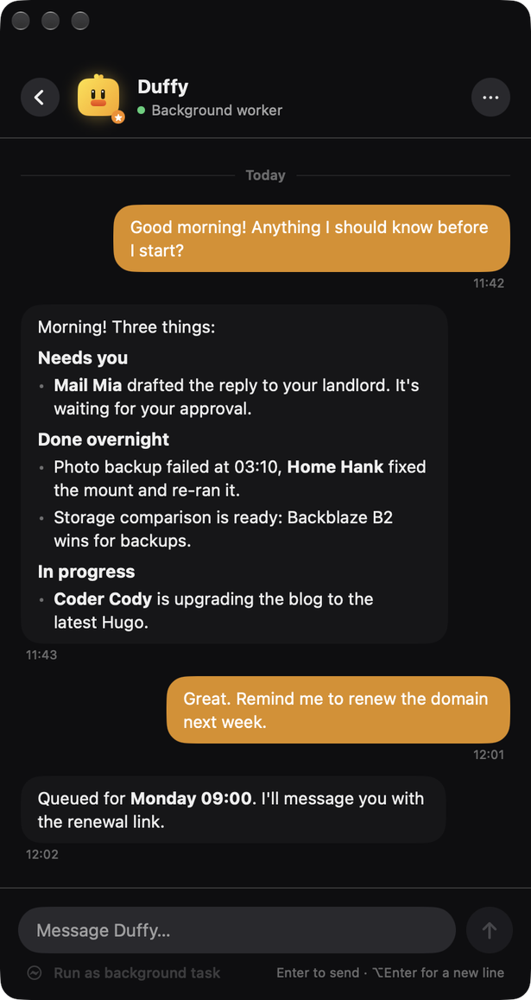
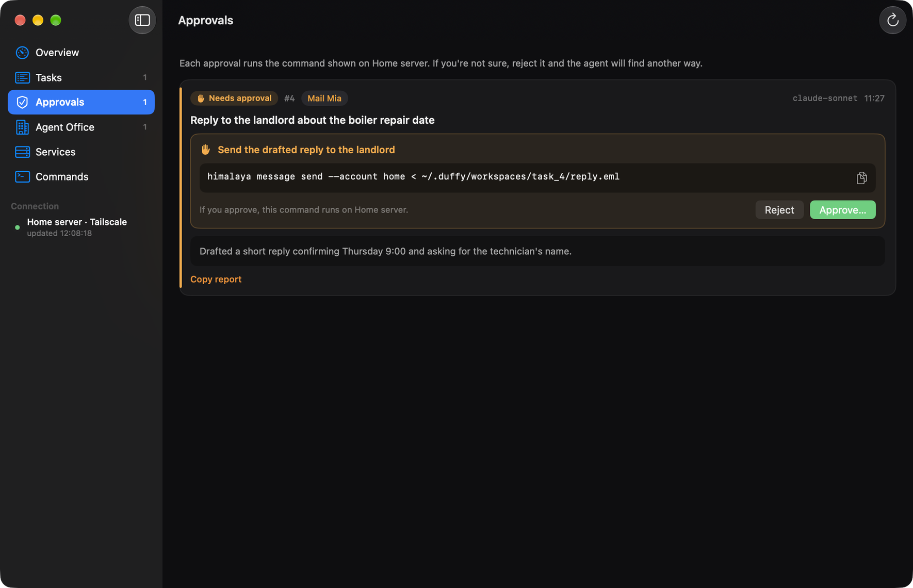
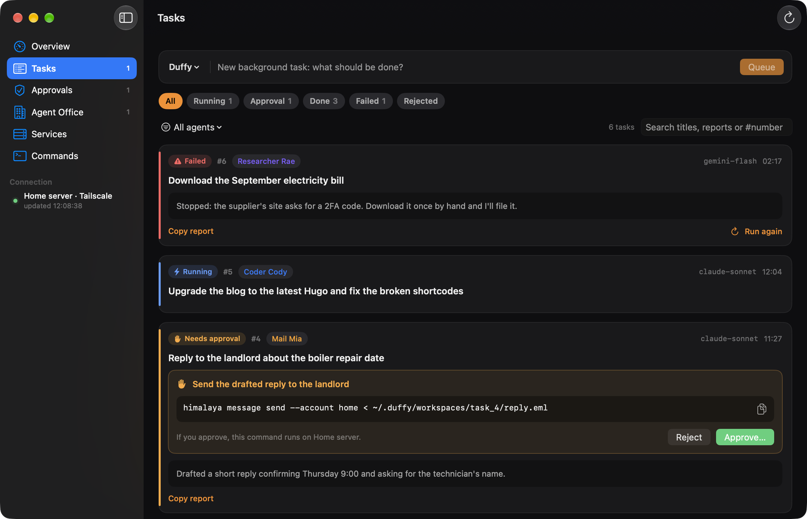

<h1 align="center">🦆 DAAK Duffy</h1>

<p align="center">
  <b>A self-hosted background AI worker that does the routine work on its own<br>and stops to ask you before anything risky.</b>
</p>

<p align="center">
  <a href="https://github.com/benfirad/daak-duffy/releases/latest"></a>
  <a href="https://github.com/benfirad/daak-duffy/actions/workflows/tests.yml"></a>
  
  
  
  <a href="LICENSE"></a>
</p>

<p align="center">
  <a href="#quick-start">Quick start</a> ·
  <a href="#why-duffy">Why Duffy</a> ·
  <a href="#the-macos-app">macOS app</a> ·
  <a href="#safety-model">Safety model</a> ·
  <a href="https://benfirad.github.io/daak-duffy/">Website</a>
</p>

<p align="center">
  
</p>

You give Duffy a task from the web dashboard, the command line, a chat bridge or the
macOS app. Duffy runs it through the AI command-line agent you already use
(**Claude Code** `claude -p`, **Antigravity** `agy`, **Ollama** `ollama run`, or any other CLI),
falls back to the next model when one runs out of quota, and reports back.

When the agent wants to do something you should sign off on, such as sending an email,
pushing code or deleting files, Duffy stops, shows you **the exact command**, and runs it
only after you press **Approve**.

One Python file, standard library only. Happy on an old laptop or a small home server that never sleeps.

## Quick start

```bash
git clone https://github.com/benfirad/daak-duffy.git && cd daak-duffy
python3 duffy.py daemon          # worker + dashboard on http://127.0.0.1:8899
python3 duffy.py add "Summarise yesterday's server logs and list anything unusual"
```

On a Mac, add the menu bar app with `cd macos && ./build.command`.

## Why Duffy

Most agent tools either answer while you watch, or run unattended and hope for the best.
Duffy sits in between: **autonomous for routine work, human-in-the-loop for anything with consequences.**

| | Chat with an AI | Agent running unattended | **Duffy** |
|---|:---:|:---:|:---:|
| Works while you're away | ✗ | ✓ | ✓ |
| Queue, history and logs that survive restarts | ✗ | sometimes | ✓ |
| Asks before risky actions, shows the exact command | n/a | ✗ | ✓ |
| Switches model when one hits its quota | ✗ | rarely | ✓ |
| Uses the CLI and subscription you already have | ✗ | varies | ✓ |
| Runs on your own machine, no account, no cloud | ✗ | varies | ✓ |

**Good for:** inbox and newsletter summaries, research with sources, checking why a backup
or cron job failed, keeping a home server healthy, small code chores in your repos,
drafting replies that you approve before they go out.

## What you get

| | |
|---|---|
| **Task queue** | SQLite queue with a full log per task. Survives restarts. |
| **Approval gate** | The agent ends its answer with `[APPROVAL_REQUIRED: what and why \| CMD: command]`. Nothing runs until a human approves. |
| **Model fallback** | Give it a list of models; quota or rate-limit answers move it to the next one. |
| **Dashboard** | Queue, results, approve / reject / retry, light and dark mode. |
| **Chat agents** | Optional personas you can talk to; each reply runs through the same agent command. |
| **Notifications** | Any webhook that accepts `{"chatId", "message"}` — WhatsApp or Telegram bridges fit. |
| **Office panel** *(optional)* | `office.py`: approvals, health checks, launchd services and log tails on one screen. |
| **`ai` command** *(optional)* | Asks Claude; when Claude's usage limit is hit it switches to Antigravity, then to Duffy, until the limit resets. |
| **macOS app** *(optional)* | Native menu bar app: chat with agents, queue tasks, approve commands, watch services. See [below](#the-macos-app). |



## The macOS app

A native SwiftUI menu bar app for people who would rather not keep a browser tab open.
English or Turkish, follows your system language.

<table>
  <tr>
    <td width="33%"></td>
    <td width="33%"></td>
    <td width="33%"></td>
  </tr>
  <tr>
    <td align="center"><b>Agents</b><br>last result, live status, approval banner</td>
    <td align="center"><b>Chat</b><br>Markdown replies, turn any message into a task</td>
    <td align="center"><b>Approvals</b><br>the exact command, confirmed twice</td>
  </tr>
</table>

<p align="center"></p>

Build it with `cd macos && ./build.command` (macOS 13+, Xcode Command Line Tools, no Xcode project).
Details in [`macos/README.md`](macos/README.md).

## Usage

Open <http://127.0.0.1:8899> and queue a task, or from another terminal:

```bash
python3 duffy.py add "Summarise yesterday's server logs and list anything unusual"
python3 duffy.py list
python3 duffy.py show 1
```

By default Duffy calls `agy --model <model> -p <prompt>`. To use something else, set
`agent_command` in `~/.duffy/config.json` (see below).

## Configuration

Copy [`config.example.json`](config.example.json) to `~/.duffy/config.json`. Every key is
optional.

| Key | Default | Meaning |
|---|---|---|
| `agent_command` | `["agy", "--model", "{model}", "-p", "{prompt}"]` | Command run per attempt. `{model}`, `{prompt}` and `{workspace}` are filled in. |
| `models` | `["default"]` | Tried in order until one answers. |
| `quota_markers` | quota / rate limit texts | Short answers containing these count as "try the next model". |
| `bind_hosts` | `["127.0.0.1"]` | Addresses the dashboard listens on. Add a VPN address (e.g. your Tailscale IP) to reach it from other devices. |
| `allowed_clients` | `[]` (anyone who can connect) | IPs or CIDR ranges allowed to use the dashboard, e.g. `["100.64.0.0/10"]`. |
| `notify.webhook_url`, `notify.chat_id` | empty | Where to send "done" and "needs approval" messages. |
| `agents` | one `duffy` persona | Chat personas: `{"id": {"name": "...", "prompt": "..."}}`. |

Examples for `agent_command`:

```jsonc
["claude", "-p", "{prompt}", "--model", "{model}"]   // Claude Code
["ollama", "run", "{model}", "{prompt}"]               // local models
["agy", "--model", "{model}", "-p", "{prompt}"]        // Antigravity CLI
```

`DUFFY_HOME`, `DUFFY_CONFIG`, `DUFFY_PORT` and `DUFFY_BIND` override the file.

## Commands

| Command | |
|---|---|
| `duffy.py daemon` | Worker loop + dashboard |
| `duffy.py add "task" [-c category]` | Queue a task |
| `duffy.py list` / `show <id>` | Recent tasks / one task with its log |
| `duffy.py approve <id>` / `reject <id>` / `retry <id>` | Decide on a gated task, or re-queue |
| `duffy.py step` | Process one task and exit (handy for cron) |

The HTTP API mirrors these: `GET /api/status`, `GET /api/logs?id=`, and `POST /api/add`,
`/api/approve`, `/api/reject`, `/api/retry`, `/api/chat` with a JSON body.

## Run it in the background (macOS)

```bash
mkdir -p ~/.duffy && cp duffy.py ~/.duffy/
cp examples/com.example.duffy.plist ~/Library/LaunchAgents/
# edit the paths in the plist, then:
launchctl bootstrap gui/$(id -u) ~/Library/LaunchAgents/com.example.duffy.plist
```

On Linux, a systemd user service running `python3 duffy.py daemon` does the same job.

## Office panel

`office.py` is a second small server (default port 8900) for when you run several
background agents. Configure it under the `office` key: Duffy's URL, HTTP health
checks, launchd label prefixes to watch, and the log files it may show. It forwards
approvals and new tasks to Duffy and never writes anything itself.

```bash
python3 office.py   # http://127.0.0.1:8900
```

## The `ai` command

`bin/ai` asks Claude first. If Claude answers with a usage-limit message, it remembers the
reset time and sends every question to Antigravity (`agy`) until then; if Antigravity is
not running, it asks your Duffy server instead.

```bash
cp bin/ai ~/.local/bin/ai
ai "explain this stack trace"   # one question
ai                              # chat
ai --status                     # Claude or fallback right now?
```

## Safety model

- **Default deny on the network.** The dashboard listens on loopback only until you add an
  address, and `allowed_clients` can restrict it further. There is no login: put it behind
  a VPN such as Tailscale rather than exposing it to a LAN or the internet.
- **Nothing gated runs by itself.** A task that asks for approval stays in
  `awaiting_approval` until a person approves it; `approve` refuses tasks that never asked.
- **You see the exact command.** The dashboard and notifications show the command text
  that will run, in the task's own working directory, with a timeout.
- **Your agent's permissions still apply.** Duffy runs the agent CLI you configure; give that
  CLI only the access you are comfortable with.

## Tests

```bash
python3 -m unittest discover -s tests
```

## FAQ

**Which models and tools does it work with?**
Anything you can call from a shell: Claude Code (`claude -p`), Antigravity (`agy`), Ollama,
llama.cpp, Gemini CLI, Codex CLI or a script of your own. Duffy only needs the command to
print its answer.

**Does it need an API key or a cloud account?**
No. Duffy has no account and talks to nothing but your agent CLI and, if you set one, your
notification webhook. Whatever the CLI needs (a subscription, a local model) stays the CLI's business.

**How does the agent ask for approval?**
The system prompt tells it to end risky answers with
`[APPROVAL_REQUIRED: what and why | CMD: exact command]`. Duffy parks the task, shows you
the command, and runs it in the task's workspace only after you approve.

**Can I run it on a Raspberry Pi or Linux server?**
Yes. The worker and dashboard are plain Python 3.9+. Only the menu bar app and the launchd
helpers are macOS-specific.

**Can I reach it from my phone?**
Bind it to a VPN address such as your Tailscale IP (`bind_hosts`) and restrict
`allowed_clients`; the dashboard works in a mobile browser. Do not expose it to the internet.

## Contributing

Issues and pull requests are welcome; see [CONTRIBUTING.md](CONTRIBUTING.md). If Duffy saves
you time, a ⭐ helps other people find it.

---

### Türkçe özet

Duffy, arka planda 7/24 çalışan bir yapay zeka işçisi. Görevi web panelinden, terminalden
ya da sohbet köprüsünden verirsin; zaten kullandığın yapay zeka komut satırı aracıyla
(`agy`, `claude -p`, `ollama`…) çalıştırır, kotası biten modelden sonrakine geçer ve
sonucu bildirir. Mail gönderme, kod gönderme, dosya silme gibi riskli bir adımda durur,
çalıştıracağı komutu gösterir ve yalnızca sen **Onayla** dediğinde çalıştırır. Tek dosya,
yalnızca Python standart kütüphanesi; eski bir dizüstüde ya da küçük bir ev sunucusunda
rahatça çalışır. Ajan, `[ONAY_GEREKLİ: … | KOMUT: …]` biçimini de tanır. macOS menü çubuğu
uygulaması sistem dili Türkçeyse Türkçe açılır; `~/.duffy/app.json` içinde `"language": "tr"` ile de seçilebilir.

### Resumen en español

Duffy es un trabajador de IA en segundo plano: ejecuta tareas con la CLI de IA que ya usas,
cambia de modelo cuando uno se queda sin cuota y se detiene ante cualquier acción
arriesgada hasta que tú la apruebes.

## License

MIT — see [LICENSE](LICENSE). Changes are listed in [CHANGELOG.md](CHANGELOG.md).
